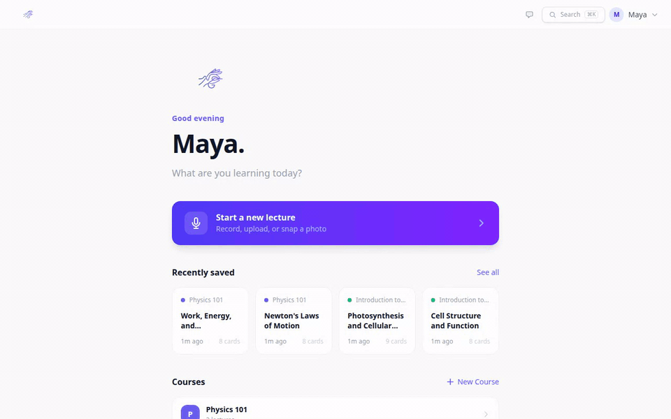
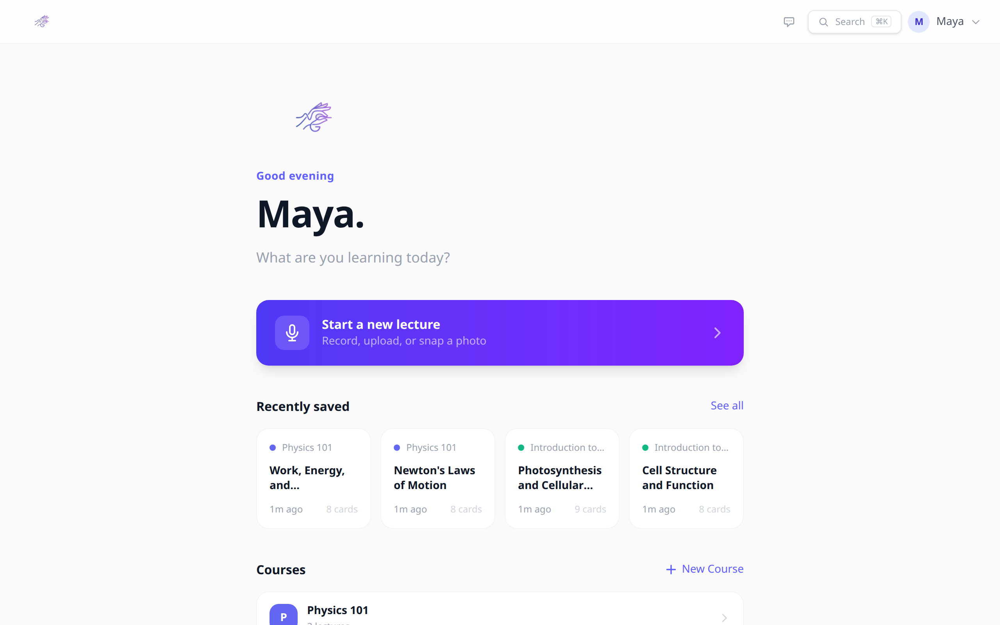
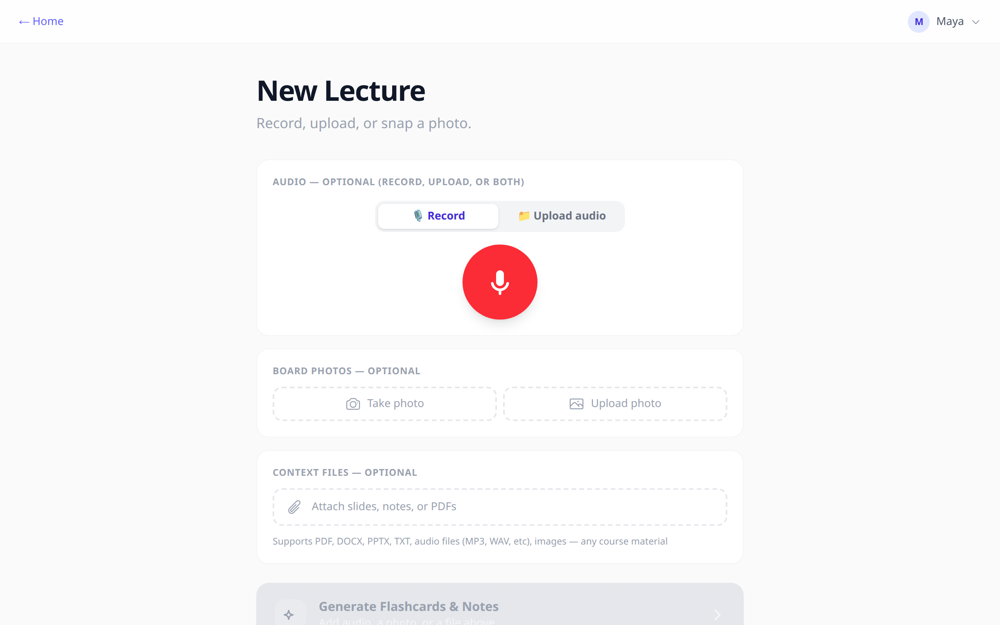
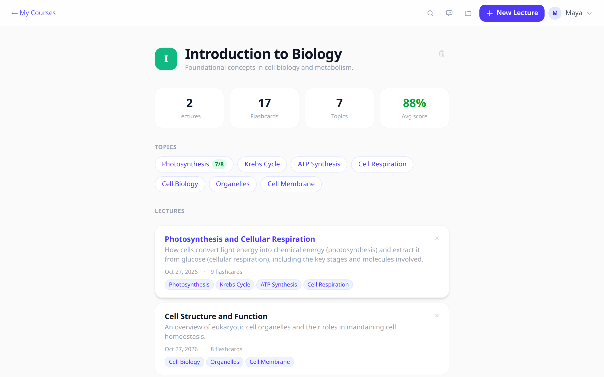
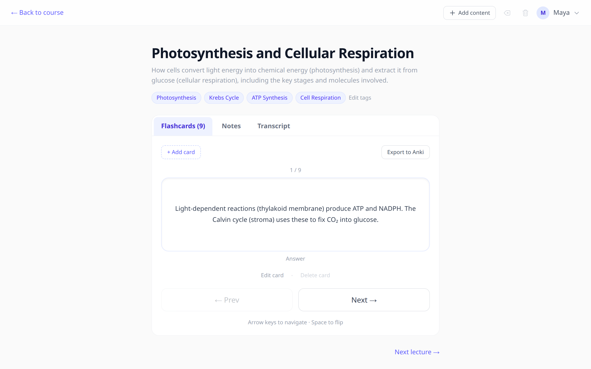
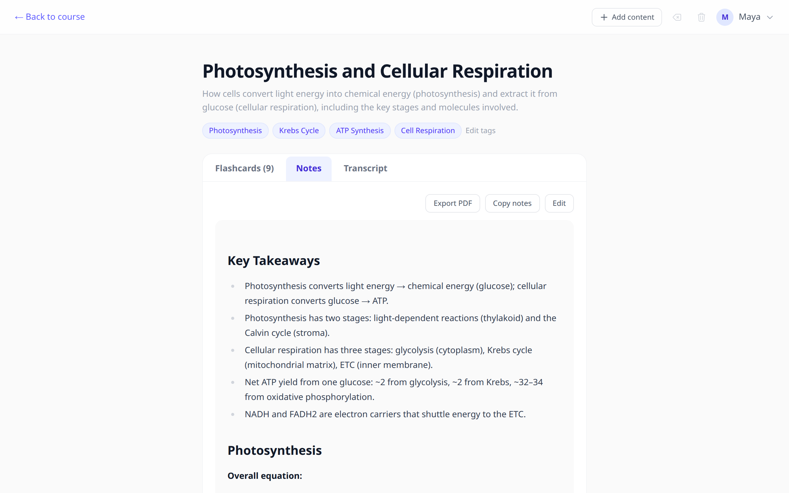
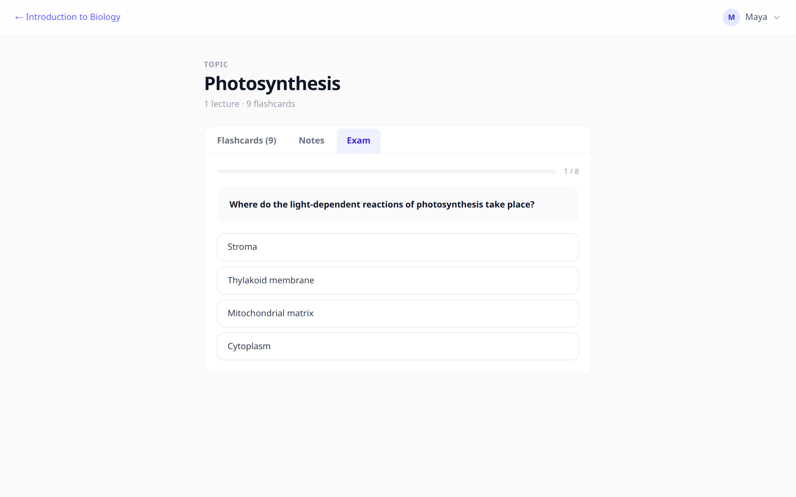
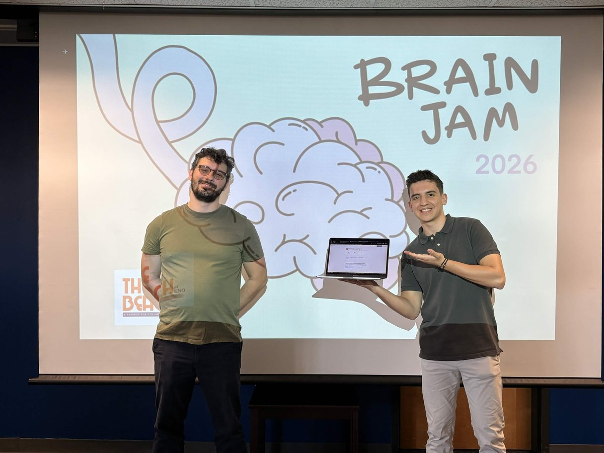

<p align="center">
  
</p>

<h1 align="center">GraspIt</h1>

<p align="center">
  Turn any lecture into a study kit: notes, flashcards and practice exams, generated from what was actually said in class.<br>
  <b>🏆 Winner of BrainJam 2026</b>, the University of New Orleans hackathon hosted by The Beach UNO.
</p>

<p align="center">
  <a href="https://github.com/GraspIt-AI/GraspIt/actions/workflows/ci.yml"></a>
  <a href="LICENSE"></a>
</p>

<p align="center">
  
</p>

## The problem

In a lecture you're trying to listen, take notes, understand and remember, all at once. Nobody can do all four. You end up with half the notes, a recording you never play back, and slides the professor may or may not post.

GraspIt lets you just pay attention. Record the lecture (or upload the audio), snap the whiteboard, attach the slides, and hit **Generate**. A minute later you have structured notes, a flashcard deck and a summary, filed under the right course and tagged by topic.

At the final presentation we had GraspIt recording our own pitch the whole time. At the end we hit Generate and the judges watched it build flashcards about the talk they had just heard.

## Features

- **Any mix of inputs.** Live recording or uploaded audio (several clips per lecture), whiteboard photos, and context files: PDF, DOCX, PPTX, XLSX, TXT, images.
- **Generated study material.** Title, summary, topic tags, flashcards and Markdown notes with LaTeX math.
- **Courses and topics.** Lectures are organised into courses. Topic tags group material across lectures, so you can study "Krebs Cycle" instead of "Lecture 7".
- **Practice exams.** Multiple-choice exams per topic, scored, with your progress tracked on the course page.
- **Course chat.** Ask questions grounded in everything recorded for that course, with streamed answers.
- **Edit everything.** Fix the transcript and regenerate, edit or add flashcards (edited cards survive regeneration), append new material to an existing lecture.
- **Export.** Anki decks (`.apkg`) per lecture or per course, and print-ready PDF notes.
- **Global search** over lecture titles, summaries, notes and topics (`⌘K` / `Ctrl+K`).

## Screenshots

| | |
|---|---|
|  |  |
| **Home**: recent lectures and courses | **New lecture**: record, upload, snap, attach |
|  |  |
| **Course**: topics, lectures, exam average | **Flashcards**: flip with Space, arrows to move |
|  |  |
| **Notes**: Markdown + LaTeX, PDF export | **Topic exam**: multiple choice, scored |

## How it works

```
 audio ──► Groq Whisper large-v3 ──► transcript ─┐
 photos ─────────────────────────────────────────┼──► Gemini 2.5 Flash ──► JSON: title, summary,
 PDF / DOCX / PPTX / XLSX (text extracted) ──────┘     (multimodal)          tags, flashcards, notes
                                                                                   │
                                                          Django + SQLite ◄────────┘
                                                                │
                                         React app: courses · topics · exams · chat · Anki
```

- **Backend:** Django 6 + Django REST Framework, JWT auth (`simplejwt`), SQLite. Office files are parsed with `python-pptx`, `python-docx` and `openpyxl`; Anki decks are built with `genanki`. Long generations stream keep-alive bytes so proxies don't time out, and the JSON parser recovers from the occasional malformed model output.
- **Frontend:** React 19, Vite, TypeScript, TanStack Router + Query, Tailwind CSS v4.
- **AI:** Groq-hosted Whisper for transcription; Google Gemini 2.5 Flash for generation, exams and chat.
- **Cost guard:** every endpoint that calls a model needs a login and is rate-limited per user (default 60/hour); register and login are rate-limited per IP.

## Run it locally

You need Python 3.12+, Node 20.19+ and two free API keys: [Groq](https://console.groq.com/keys) and [Google AI Studio](https://aistudio.google.com/apikey).

```bash
git clone https://github.com/GraspIt-AI/GraspIt.git && cd GraspIt
cp .env.example .env          # then paste your GROQ_API_KEY and GEMINI_API_KEY

# backend → http://localhost:8000
cd backend
python3 -m venv venv && source venv/bin/activate
pip install -r requirements.txt
cd brainjam
python manage.py migrate
python manage.py runserver

# frontend → http://localhost:5173 (in a second terminal)
cd frontend
npm install
npm run dev
```

Open http://localhost:5173 and create an account. New accounts start with two sample courses (Biology and Physics), so you can look around before recording anything.

The dev server proxies `/api` to `localhost:8000`. If your backend runs elsewhere, start the frontend with `VITE_API_URL=http://localhost:<port> npm run dev`.

### Tests

```bash
cd backend/brainjam && DEBUG=True python manage.py test
```

### Deploying

`backend/railway.toml` and `netlify.toml` hold the configs we used (Railway for the API, Netlify for the frontend). For any public deployment, set `DEBUG=False`, a long random `SECRET_KEY`, `ALLOWED_HOSTS`, and `VITE_API_URL` on the frontend build. The backend refuses to start without a `SECRET_KEY` when `DEBUG` is off. SQLite is fine for a demo but is wiped on every redeploy on hosts without a persistent disk.

## Project layout

```
backend/
  brainjam/          Django project (settings, urls). Named after the hackathon.
    api/             models, views (generation pipeline, exams, chat, Anki), tests
    users/           custom email-based user model
  requirements.txt
frontend/
  src/routes/        pages: home, record, course, lecture, topic, login/register
  src/components/    recorder, photo capture, flashcards, notes viewer, chat, search
docs/                screenshots and demo GIF
```

## Team

Built in a weekend for BrainJam 2026 at the University of New Orleans by:

- **Enrique Hernández**: [@Enrikkk](https://github.com/Enrikkk)
- **Ayush Raj Dahal**: [@ayushrajdahal](https://github.com/ayushrajdahal)
- **Cosme Boisset**: [@Boisset-C](https://github.com/Boisset-C)

<p align="center">
  
  <br>
  <sub>Cosme and Enrique presenting GraspIt at BrainJam 2026.</sub>
</p>

## License

[MIT](LICENSE)
